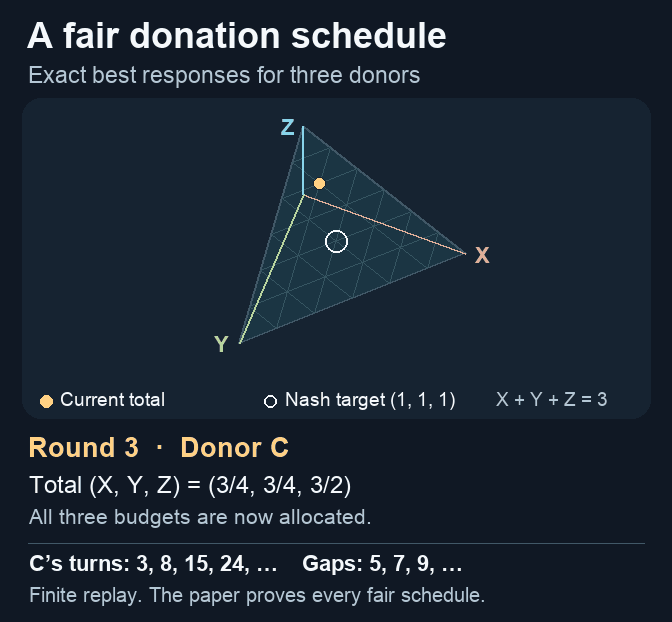

# Fair best-response dynamics for Leontief donations

   

Must the aggregate allocation converge when every donor moves infinitely often, even if the waiting times have no uniform bound? The original question appears in [Greger, dissertation, Open Problem 5, p. 99](https://mediatum.ub.tum.de/doc/1759811/onlts4hzyc7oqggwzeixzb01l.Matthias%20S.%20Greger.pdf#page=115).

**Result.** For finite Leontief donor coordination with positive budgets, nonempty supports and arbitrary nonnegative weights, the aggregate under best responses from zero converges to the unique Nash-welfare allocation for every fair schedule.

[Read the paper (PDF)](paper/manuscript.pdf) · [LaTeX source](paper/manuscript.tex) · [Proof guide](proof/PROBLEM_AND_PROOF.md) · [Reproduce the checks](REPRODUCIBILITY.md)

## Explore the proof in 3D

Each coordinate is the total donated to one project. Each donor has one unit to give. Once all three have moved, the point stays on the plane where the three coordinates sum to three. Donors A and B take turns for longer and longer stretches before C returns. [Download the offline explorer](https://github.com/DannyExperiments/fair-leontief-donation-dynamics/raw/refs/heads/main/visualization/fair-leontief-explorer.zip), unzip it and open the HTML file to rotate the view and step through the allocations.

## Why arbitrarily long waits matter

Each donor cares about the *least* funded of the projects they support, relative to their weights. When their turn comes, they use their budget to raise that bottleneck as far as possible. “Fair” means that every donor gets infinitely many turns. In the example, C moves on turns 3, 8, 15, 24, 35 and 48. The schedule continues with increasingly long gaps.

The general proof follows a bounded quantity called a potential. Every update improves it or leaves it unchanged, so the gains per turn tend to zero. Imagine returning arbitrarily close to an allocation where some donor would still gain by moving. Wait for the first turn of any such donor. There may be many intervening updates. The proof shows that in the limit these updates preserve the aggregate on the projects, while that waiting donor’s own contribution has stayed fixed. Those two facts preserve her strictly positive gain. This contradicts the vanishing gains along the trajectory.

Every limiting aggregate is therefore the unique allocation maximizing the weighted Nash product. The theorem concerns the totals on projects and gives no bound on the number of turns needed.

## What you can check

The [proof](paper/manuscript.pdf) establishes convergence for every fair schedule and for arbitrary nonnegative weights with nonempty supports. The [finite replay](verification/src/replay.py) follows 74 schedule blocks with growing gaps. The [figure guide](visualization/README.md) explains the separate three-donor worked example.

Internally reviewed, not peer reviewed. [Mathematical audit](audits/public_safe_reports/MATHEMATICAL_AUDIT.md) · [Literature and priority](audits/public_safe_reports/LITERATURE_AUDIT.md) · [Citation](CITATION.cff)

## Partial Lean verification

For any finite list of rational donor rows, every nonnegative allocation attaining the water level with the same total as the coordinate shortfalls equals the shortfall allocation in each row. [Scope, source and replay](formalization/README.md)
